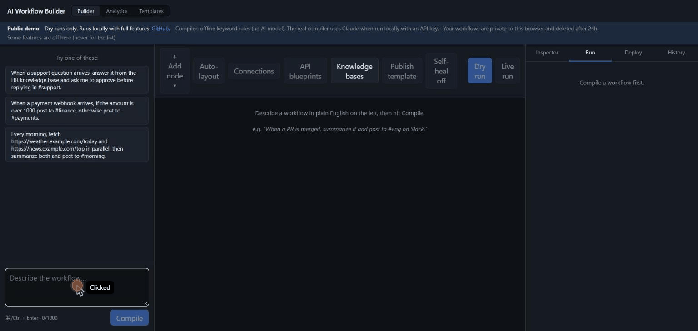

# AI Workflow Builder

Plain-English intent → a visual node graph → an executable, deployable automation pipeline.



<!-- Once deployed (see "Deploying the demo"), add the link here:
**[Live demo](https://workflows.<domain>)**: public demo mode, dry runs only.
-->

The design has four core phases: trigger and input configuration, AI compilation of the
request into a DAG, durable step-by-step execution, and testing, debugging and deployment.
On top of those come human approvals, self-healing, branching and parallel paths, version
history, analytics, templates, OpenAPI ingestion, local execution, sandboxed code and image
nodes, and knowledge bases (RAG). See [Status](#status).

## Stack

| Layer | Choice | Why |
|---|---|---|
| Execution engine | **Temporal** (TypeScript SDK) | Durable, stateful, per-node retries — blueprint Phase 3, for free |
| API | **Hono** on Node | Small, fast HTTP layer |
| Compiler | **Claude** (`@anthropic-ai/sdk`, structured outputs) behind a provider interface | NL → DAG |
| Persistence | **PostgreSQL** + **Drizzle ORM** | Workflows, runs, per-node run rows |
| Canvas / chat UI | **React** + **Vite** + **React Flow** (`@xyflow/react`) + **Zustand** | Node graph + chat + run inspector |
| Local infra | **Docker Compose** | Postgres + Temporal dev server (+ Temporal UI on :8233) |

Monorepo via npm workspaces:

```
packages/core     shared DAG schema, node catalog, validation, topological sort, templating
apps/api          Hono server: /compile, workflow CRUD, run starter
apps/worker       Temporal worker: the executeWorkflow engine + per-node activities
apps/web          React canvas + chat + run panel
```

## Milestone 1 — the vertical slice (done)

A prompt flows end-to-end across all four blueprint phases:

1. **Phase 1 — input** — type a workflow in plain English in the chat panel.
2. **Phase 2 — compile** — `POST /api/workflows/compile` sends it to Claude (or the offline
   stub), which returns a validated DAG of typed nodes. It's auto-laid-out and saved.
3. **Phase 1 — canvas** — the graph renders live on the React Flow canvas.
4. **Phase 3 — execute** — "Dry run" starts a Temporal workflow that walks the DAG in
   topological order, running each node as its own activity (isolated retries, per-node
   state). Templating (`{{ trigger.pull_request.title }}`) resolves between nodes.
5. **Phase 4 — inspect** — the run panel shows every node's status, inputs, outputs, logs,
   and attempt count; node borders on the canvas turn green/red.

Node kinds so far: `trigger`, `llm`, `http_request`, `transform` (sandboxed JS expression),
`slack_post`. Dry runs never make external calls — HTTP is mocked, Slack is not sent, LLM
returns a deterministic mock (`DRY_RUN_LLM=live` overrides that).

## Milestone 2 — editable canvas (done)

The canvas is now a real editor, not just a viewer of the AI's output:

- **Inspector panel** — select any node to edit its label and typed config fields
  (text / textarea / select / JSON), driven by a node-catalog schema from the API.
- **Add / delete nodes** — a palette menu for every node kind; delete from the inspector
  or with the Delete key.
- **Connect / disconnect** — drag between handles to add edges; select + Delete to remove.
- **Live validation** — per-node config errors surface as a marker on the node, a list in
  the inspector, and an error count in the toolbar; runs are blocked while errors exist.
- **Auto-layout** button, and manual node positions are now preserved on save.
- Debounced autosave with a "Saved / Saving…" indicator.

## Setup

Prereqs: Node 20+, Docker Desktop.

```bash
npm install
cp .env.example .env          # add ANTHROPIC_API_KEY for the real compiler; set SECRET_KEY for prod
npm run infra:up              # Postgres (with pgvector) + Temporal (Temporal UI: http://localhost:8233)
npm run db:push               # enable pgvector + create tables
npm run dev                   # core (watch) + api :8787 + worker + web :5173
```

Open http://localhost:5173.

- `COMPILER_MODE=stub` (default) — no API key needed. A rule-based offline compiler: it reads the trigger type, URLs to fetch or send to, knowledge bases, loops, LLM steps, one if/otherwise branch, approvals and Slack channels from the prompt. Good for demos and engine work; not an AI.
- `COMPILER_MODE=claude` — real compilation; needs `ANTHROPIC_API_KEY`. Model via `COMPILER_MODEL` (default `claude-sonnet-5`).
- `EMBEDDINGS_MODE=local` (default) — knowledge-base embeddings run in-process; the model (~130 MB) downloads once on first use. `RERANK_MODE=local` likewise for the optional re-ranker (~90 MB). `EMBEDDINGS_MODE=voyage` needs `VOYAGE_API_KEY` and `EMBEDDING_DIMENSIONS=1024` (then clear `kb_chunks` and re-run `db:push`).

## Useful commands

```bash
npm run typecheck             # all workspaces
npm test                      # unit tests (chunker, RRF, grounding, eval scorer + report)
npm run eval:retrieval        # retrieval eval -> apps/api/eval/results.md
npm run eval:compiler -w apps/api -- --repeats 1   # compiler eval -> apps/api/eval/compiler-results.md
npm run build                 # all workspaces
npm run db:studio             # Drizzle Studio
npm run infra:down            # stop containers
```

## Milestone 3 — Secure Hub + Agent Deployment (done)

- **Secure Hub** — a credential vault (`connections`). Secrets are AES-256-GCM
  encrypted at rest, decrypted only inside the execution engine (the worker
  fetches them over a token-gated internal endpoint at activity time), and never
  returned to the browser or embedded in a graph. `slack_post` and `http_request`
  nodes can reference a connection; there's a Connections manager in the UI.
- **Agent Deployment** — "Deploy" compiles the current graph into a live webhook
  listener at `POST /api/hooks/<token>`. The graph is snapshotted at deploy time.
  Posting a JSON body starts a **live** run with that body as the trigger payload;
  deployments can be paused, deleted, and test-fired from the Deploy panel.
- Failed-node errors now surface the real cause instead of Temporal's wrapper.

## Milestone 4 — live run streaming (done)

Runs no longer block. `POST …/runs` returns a `runId` immediately; the engine
workflow exposes its per-node state through a Temporal query, and
`GET /api/runs/:id/stream` (Server-Sent Events) relays it. The canvas lights up
node-by-node as the engine executes — the active node pulses, finished nodes go
green/red, edges animate — and the final run is persisted in the background
whether or not anyone is watching. Opening a stream for a finished run replays
the stored result.

## Milestone 5 — model routing + scheduled triggers (done)

- **Model routing** (Phase 2 "Model Selection") — a heuristic complexity router
  scores the compile request (length, conditionals, step count, integrations,
  reasoning verbs) and picks a tier → model: `fast` (Haiku), `balanced` (Sonnet),
  `deep` (Opus). The compiler also assigns each `llm` node a tier, editable in
  the inspector; tiers map to concrete models via env so graphs stay model-free.
- **Scheduled triggers** (Phase 4 "background service") — a workflow can run on a
  cron schedule. `POST /api/workflows/:id/schedule` snapshots the graph; the API's
  in-process scheduler fires due schedules as `trigger=schedule` live runs with a
  `{ scheduledFor, cron }` payload. Pause / resume / delete from the Deploy panel,
  with cron presets and the browser's timezone.

## Expansion #4 — conditional branching & parallel paths (done)

The engine is no longer linear:

- Every node whose inputs are ready runs **in parallel** (each is its own
  Temporal activity), so independent steps fan out.
- A **`branch` node** evaluates a JS condition; its outgoing edges carry a
  `"true"` / `"false"` handle and only the taken side stays live. The other
  side's descendants are skipped, and skips propagate.
- Merge nodes use an **OR-join** — they run as soon as any one live path
  reaches them, with the merged outputs of whichever upstreams completed.

## Expansion #1 — Human-in-the-Loop approvals (done)

An **`approval` node** pauses the run before a sensitive step. When the engine
reaches it the workflow blocks on a Temporal signal and the node shows as
`awaiting` in the run panel with the (templated) approval message and
Approve / Reject buttons. `POST /api/runs/:id/approve` signals the decision;
approve resumes the workflow, reject fails the node and skips everything
downstream. The run stays open (no polling cost beyond the progress stream)
until a decision arrives.

## Expansion #5 — version control & rollbacks (done)

Every workflow keeps an append-only list of graph **snapshots**. One is written
on compile, on an explicit "Save version", on deploy, and before each run —
deduped by a position-independent signature so unchanged graphs don't pile up.
The **History** tab lists them with source and timestamp; "Restore" rolls the
working graph back to that version (snapshotting the current state first, so the
rollback is itself reversible).

## Expansion #7 — analytics dashboard (done)

A **Builder / Analytics** toggle in the top bar. The Analytics view aggregates
every run and node execution: stat tiles (runs, success rate, avg run time, node
executions), a 14-day stacked runs-over-time chart, a per-node-kind performance
table (count, success rate, p50/p95 latency), a failures-by-node bar chart, and a
recent-runs table. `node_runs` now carries the node `kind` for grouping.

## Expansion #2 — AI self-healing (done)

Per-workflow **Self-heal** toggle (top bar). When on, a node that fails after its
Temporal retries is sent — its kind, config, the error, and the input it
received — to the model, which returns a corrected config. The engine applies it
and retries the node once; a heal that works shows as `succeeded` with a
`self-healed` badge and a was → now config diff in the run panel, a heal that
doesn't leaves the node failed with the reason logged. Healable kinds:
`http_request`, `slack_post`, `llm`, `transform`, `branch`. Needs `ANTHROPIC_API_KEY`.

## Loop / iterator node (done)

A **`loop` node** maps a per-item JS expression over an array from upstream:
`items` resolves to the array, `expression` runs once per element with `item`,
`index`, and `input` in scope, and the output is `{ results, count }` for
downstream nodes to aggregate.

## Expansion #9 & #10 — sandboxed code + 2D asset nodes (done)

- **`code` node** runs a multi-line JS function body in a separate `worker_threads`
  Worker with its own globals, a memory cap, and a hard timeout (the thread is
  terminated on overrun). `input` is in scope; `return` a value.
- **`asset` node** generates and minifies an SVG (card / badge / banner) from a
  templated title, subtitle, and accent colour; output carries `svg`, a base64
  `dataUri`, and dimensions, and the run panel previews the image inline.

## Expansion #8 — community template marketplace (done)

A third **Templates** view. `templates` table + routes: browse, `POST` publishes
the current workflow (button in the Builder toolbar), `POST …/clone` forks a
template into a fresh workflow and drops you back in the Builder, delete for
community entries. Three built-in templates are seeded on first boot.

## Expansion #3 — custom API blueprinting (OpenAPI ingestion) (done)

Paste an OpenAPI v2/v3 JSON doc in the **API blueprints** manager; it's distilled
to a flat list of operations (method, path, params, base URL). An **`api_call`
node** picks a `blueprintId` + `operationId`, fills path/query/body params from a
templated `args` JSON, and optionally attaches an auth connection. The compiler
gets a compact list of ingested operations so it can wire `api_call` nodes into
generated workflows.

## Expansion #6 — local execution node (done)

A **`local` node** runs a shell command on your own machine so files never touch
the cloud. When the engine reaches it, it enqueues a `local_tasks` row and the
workflow pauses on a Temporal signal (`awaiting`). A standalone poller —
`apps/local-runner` (`npm run local-runner`) — claims the task, runs the command
in its working directory, and POSTs back stdout/stderr/exitCode, which signals
the run to resume (or fail on a non-zero exit / a 15-minute no-response timeout).

## Knowledge Bases (RAG) (done)

Workflows can answer from your own documents. Upload PDFs, Markdown, text, HTML
or a URL into a **knowledge base** (toolbar → **Knowledge bases**); a **`retrieve`
node** finds the most relevant chunks for a templated query, and an `llm` node
with **Require citations** answers from them, citing `[chunk:<id>]`. No RAG
framework and no separate vector database: chunking, embedding calls, retrieval
and fusion are plain code over **pgvector** in the existing Postgres.

- **Ingestion** is a Temporal workflow (`ingestDocument`): parse → chunk →
  embed in batches of 64 → store in one transaction, each step its own activity
  with its own retries. The chunker (`packages/core/src/chunk.ts`) targets ~500
  tokens with ~75 of overlap, never spans a heading, and splits by paragraph,
  then sentence, then word - never mid-word.
- **Embeddings** default to a local model (`bge-small-en-v1.5` via
  transformers.js, `EMBEDDINGS_MODE=local`), so everything works with no API
  key; `EMBEDDINGS_MODE=voyage` uses Voyage AI. A KB records the model it was
  built with and refuses queries from a different one.
- **Search modes**: `vector` (HNSW, cosine), `keyword` (Postgres full-text,
  GIN), and `hybrid` - both, merged with **Reciprocal Rank Fusion**
  (`score = Σ 1/(60 + rank)`, `packages/core/src/rrf.ts`). Ranks are fused
  rather than raw scores because cosine similarity and `ts_rank` live on
  unrelated scales.
- **Grounding**: with citations required, the answer gets `grounded: false` if it
  cites nothing or cites a chunk it wasn't given, so a `branch` or `approval`
  node can stop an unsupported answer before it's posted.
- The compiler sees the list of KBs, so "answer HR questions in Slack from our
  policy docs" compiles to `trigger → retrieve → llm → slack_post`. A sample KB
  (a fictional employee handbook, `apps/api/seed-kb/`) and an "Answer HR
  questions from the handbook" template are seeded on boot.
- **Re-ranking** (optional, `rerank` on the retrieve node or in Test search): a
  cross-encoder re-scores the top candidates - a local
  `ms-marco-MiniLM-L-6-v2` by default (`RERANK_MODE=local`), or Voyage
  `rerank-3-lite`. Its scores are 0-1 relevance but often small, so keep
  `minScore` low when it's on.
- **Incremental re-indexing**: every chunk stores a sha256 of its content;
  re-indexing a document (or uploading an edited copy) only embeds chunks whose
  text changed - the rest reuse their stored embedding.
- **Private URLs**: a KB can use an `http_header` connection from the Secure
  Hub; the worker resolves it at fetch time and sends it when fetching that KB's
  URLs, so pages behind auth can be indexed without the secret leaving the vault.

**Retrieval eval** (`npm run eval:retrieval`; full table in
[`apps/api/eval/results.md`](apps/api/eval/results.md)): 30 questions over the
sample KB, each labelled with the document and an exact evidence phrase.

| search mode (heading-aware chunks) | recall@1 | recall@5 | MRR@10 |
|---|---:|---:|---:|
| keyword | 83.3% | 96.7% | 0.876 |
| vector | 90.0% | 100.0% | 0.944 |
| **hybrid (RRF)** | **96.7%** | **100.0%** | **0.983** |

Hybrid puts the right chunk first for 29 of 30 questions, against 27 for vector
alone and 25 for keyword alone. Chunk size made no difference with heading-aware
chunking, because every handbook section is under 300 tokens. With headings
ignored ("flat" chunking), hybrid's MRR drops to 0.950 at every size, and vector
alone falls to 73.3% recall@1 at 500 tokens - splitting on headings is worth
more here than any size setting. Re-ranking hybrid results made no difference
with heading-aware chunks (already 96.7% recall@1), but it compensated for coarse
ones: flat 800-token chunks went from 90.0% to 96.7% recall@1 (MRR 0.950 →
0.983). The corpus is small (36 chunks), so treat these as a regression check
rather than a benchmark.

## Compiler evaluation harness

`npm run eval:compiler -w apps/api` measures how often the NL → DAG compiler
produces a *correct* graph, not just a valid one. Results go to
`apps/api/eval/compiler-results.md` (tables) and `apps/api/eval/results/`
(raw JSON).

- **Test set**: 40 prompts in `apps/api/eval/compiler-cases.json` across seven
  buckets: linear (10), branching (8), parallel fan-out (6), approval (5),
  loop (4), RAG (4) and ambiguous/adversarial (3).
- **Structural expectations, not a gold graph**: many different graphs are
  correct for one request, so each case states checkable rules: required and
  forbidden node kinds, "A must be upstream of B" (true ancestry, not array
  order), "these two run in parallel", branch and node counts, trigger type.
  Ambiguous cases also pass on a clean refusal.
- **Configurations**: complexity-routed (default), always fast tier, always
  balanced tier, and routed with the repair retry disabled. Each case runs 3
  times by default, because model output varies between runs.
- **Report**: valid % and structural-match % per config, average attempts,
  p50/p95 latency, cost per compile (from the API's token `usage` and a dated
  price table), match % per bucket, repair impact, routed vs. always-balanced
  cost and accuracy, router decisions per tier, and every failure with its
  reason.
- **Safety**: a `--budget` cap (default $5) stops the run before it overspends;
  `--repeats 1`, `--cases` and `--bucket` make cheap partial runs.

The headline numbers need a paid `ANTHROPIC_API_KEY` with `COMPILER_MODE=claude`
and haven't been run yet. With the offline stub compiler the harness runs end
to end, but its accuracy numbers only describe the keyword stub. One finding
doesn't depend on the model: the complexity router sends 15 of the 40 prompts
to the fast tier, 22 to balanced and 3 (all branching) to deep, so routing is
not guaranteed to be cheaper than always using the balanced tier. The real run
will show whether it is.

## Public demo mode

Set `DEMO_MODE=true` to run the app on a public URL. The app has no user
accounts, and several features are dangerous to expose, so demo mode adds guard
rails ([`apps/api/src/demo.ts`](apps/api/src/demo.ts)):

| Off in the demo | Why |
|---|---|
| `code` and `local` nodes | `code` runs JavaScript in a worker thread, which is not a security sandbox; `local` runs shell commands |
| Live runs | They really send HTTP requests (server-side request forgery against the server's network) and Slack messages. Dry runs mock both |
| Connections (credential vault) | Strangers would be storing secrets on the server |
| Deployments, webhooks, schedules | Persistent jobs that run unattended |
| OpenAPI blueprint ingestion, knowledge base uploads, template publishing | Anyone could fill shared storage; visitors use the seeded sample knowledge base and templates |

What it adds:

- **Per-visitor isolation**: an anonymous httpOnly `awb_sid` cookie owns each
  workflow (`workflows.owner_sid`); every workflow, run, version and analytics
  query is scoped to it. Another visitor gets a 404.
- **Compile limits**: 5 compiles per hour per visitor and per IP, 1,000-character
  prompts, and a global daily cap (200) after which compiles fall back to the
  offline stub. Self-heal shares the same budget, and one dry run per visitor
  per hour can call the real model for its llm steps (fast tier). Both need an
  API key; without one the demo runs entirely offline.
- **Cleanup**: visitor workflows (with their runs and versions) are deleted
  after 24 hours.
- The API refuses all of the above with a 403, the UI greys the controls out,
  and the worker refuses live runs, `code` nodes and local tasks itself as a
  second line of defence. Tests: [`apps/api/src/demo.test.ts`](apps/api/src/demo.test.ts).

### Deploying the demo

`docker-compose.prod.yml` runs Postgres (pgvector), Temporal (dev server with a
SQLite file on a volume, UI not exposed), a one-off schema migration, the API,
the worker, and `awb-web`: nginx serving the built UI and proxying `/api` (with
buffering off for the live-run event stream). No service publishes a port; a
shared Caddy proxy reaches `awb-web` over the external `demo-proxy` network and
handles HTTPS.

On a fresh Ubuntu 24.04 server, [`deploy/setup-vm.sh`](deploy/setup-vm.sh) does all of
it in one go (Docker, swap, firewall, DuckDNS, Caddy with HTTPS, secrets, the stack):
`bash setup-vm.sh --domain <name>.duckdns.org`. By hand:

```bash
docker network create demo-proxy            # once per server, shared with Caddy
cp .env.prod.example .env.prod              # fill in the secrets (openssl rand -base64 32)
docker compose -f docker-compose.prod.yml --env-file .env.prod up -d --build
```

`GET /api/health` checks Postgres and Temporal and returns 503 if either is
down; point an uptime monitor at it.

## Status

**All four blueprint core phases and all ten Expansion features are implemented**
(#1–#10), plus a loop/iterator node and knowledge bases (RAG).
